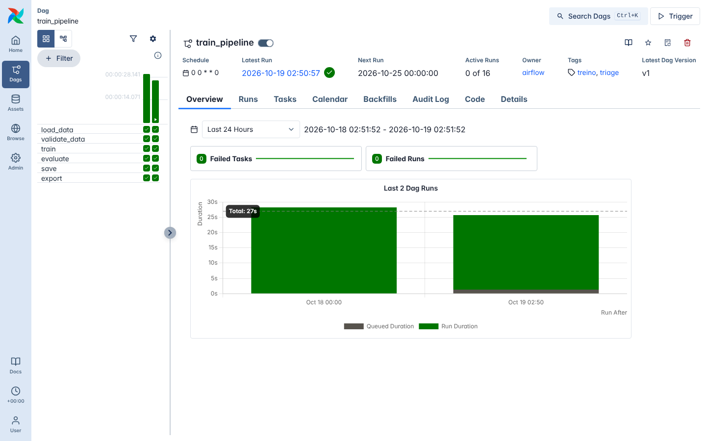
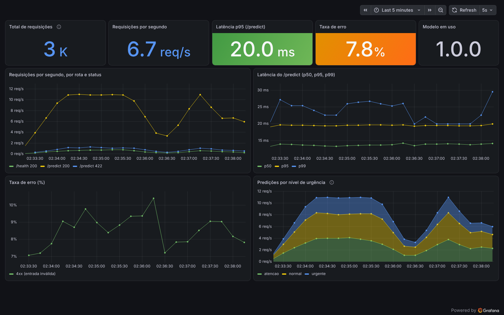

# Triagem de Relatos Médicos: Tech Challenge Fase 3 (FIAP MLET)

Classificador de texto (NLP) que lê o relato de um paciente e classifica a urgência em
**normal / atenção / urgente**. O modelo é servido por uma API REST (FastAPI) em Docker,
com CI/CD no GitHub Actions, retreino orquestrado pelo Airflow e monitoramento com
Prometheus + Grafana.


**Vídeo de apresentação (STAR, 5 min):** _link a adicionar_

---

## 1. Problema

Em um pronto-atendimento, quem chega primeiro nem sempre é quem precisa de atendimento
primeiro. A proposta é um **apoio à triagem**: a partir da frase em que o paciente descreve
o que sente, o sistema sugere um nível de urgência para **ordenar a fila**. A decisão final
continua sendo de um profissional de saúde.

## 2. Dataset

- **Fonte:** [Medical Speech, Transcription, and Intent](https://www.kaggle.com/datasets/paultimothymooney/medical-speech-transcription-and-intent) (Kaggle).
- **Arquivo usado:** `overview-of-recordings.csv`, com 6.661 linhas. Colunas usadas: `phrase` (texto) e `prompt` (categoria do sintoma).
- **Atenção:** são só **703 frases únicas**, cada uma gravada cerca de 10 vezes por pessoas diferentes.

O arquivo não fica no repositório. Para rodar o treino, baixe o dataset no Kaggle e coloque
o CSV em `data/raw/overview-of-recordings.csv`.

### Das 25 categorias para 3 níveis

O dataset não traz urgência, e sim 25 categorias de sintoma. O mapeamento abaixo é uma
**decisão de projeto** (sem validação clínica), definida em `src/triage/labels.py`:

| Nível | Critério | Categorias |
|---|---|---|
| **urgente** | risco à vida ou piora rápida | Heart hurts, Hard to breath, Internal pain, Open wound, Infected wound |
| **atenção** | merece consulta logo, mas não é emergência | Feeling dizzy, Blurry vision, Body feels weak, Head ache, Stomach ache, Cough, Feeling cold, Ear ache, Injury from sports, Emotional pain |
| **normal** | queixa leve ou crônica | Back pain, Neck pain, Shoulder pain, Knee pain, Joint pain, Muscle pain, Foot ache, Skin issue, Acne, Hair falling out |

Distribuição: normal 42%, atenção 39%, urgente 19%.

## 3. Modelo

### Preparação dos dados (`src/triage/data.py`)
- **Limpeza:** 2 linhas tinham categoria diferente das outras cópias da mesma frase e foram removidas (vale a maioria).
- **Separação treino/teste por frase:** como cada frase se repete ~10 vezes, um sorteio comum colocaria cópias da mesma frase no treino e no teste, e o modelo seria avaliado em frases que já "decorou". Usamos `StratifiedGroupKFold`, que mantém todas as cópias de uma frase do mesmo lado **e** a proporção dos 3 níveis igual nos dois lados (80% treino / 20% teste).

### Pipeline (`src/triage/model.py`)
- **TF-IDF de palavras** (1 e 2 palavras) **+ TF-IDF de pedaços de letras** (3 a 5 letras), unidos com `FeatureUnion`. Os pedaços de letras ajudam o modelo a reconhecer variações como *breath / breathing*.
- **Random Forest** com `class_weight="balanced"`, porque o nível urgente tem metade das linhas dos outros.
- Todos os hiperparâmetros e a semente (`SEED = 42`) ficam em `src/triage/config.py`, o que torna o resultado reprodutível.

### Regra de decisão: "na dúvida, urgente" (`src/triage/predict.py`)
Errar um caso urgente é o pior erro. Por isso, se a chance de urgente for **≥ 25%**
(`URGENT_THRESHOLD`), a resposta é urgente, mesmo que outro nível tenha chance maior. O custo
são mais alarmes falsos, que é a troca certa numa triagem.

### Resultados (conjunto de teste, 1.334 frases nunca vistas no treino)

| Versão | Acurácia | F1 macro | Recall urgente | Urgentes classificados como normal |
|---|---|---|---|---|
| TF-IDF palavras + RF | 0.813 | 0.790 | 0.600 | 63 |
| + pedaços de letras | 0.846 | 0.836 | 0.725 | 28 |
| **+ limiar de 25% (final)** | **0.826** | **0.812** | **0.761** | **19** |

Matriz de confusão do modelo final (linhas = verdadeiro, colunas = previsto):

| | normal | atenção | urgente |
|---|---|---|---|
| **normal** | 479 | 55 | 27 |
| **atenção** | 46 | 429 | 43 |
| **urgente** | 19 | 42 | 194 |

Os 19 urgentes que ainda viram "normal" são, na verdade, **só 2 frases** repetidas:
- *"There is an injured person"*: o rótulo é ambíguo, porque a frase não indica gravidade.
- *"...I feel crushed under a huge weight and no air passing to my lungs..."*: linguagem figurada, sem as palavras comuns do treino.

Paramos de ajustar o modelo nesse ponto de propósito: continuar ajustando olhando o conjunto
de teste seria "estudar com a prova na mão".

## 4. API

| Método | Rota | O que faz |
|---|---|---|
| `GET` | `/health` | 200 se o modelo está carregado (mostra a versão e o *backend*); 503 se não está |
| `POST` | `/predict` | recebe `{"text": "..."}` e devolve o nível |
| `GET` | `/docs` | documentação interativa (Swagger) |
| `GET` | `/metrics` | métricas para o Prometheus (seção 8) |

Exemplo:

```json
// POST /predict
{"text": "I cut my hand and it is bleeding a lot"}

// resposta
{
  "label": "urgente",
  "confidence": 0.66,
  "probabilities": {"atencao": 0.08, "normal": 0.26, "urgente": 0.66},
  "model_version": "1.0.0"
}
```

- Entrada inválida (texto vazio ou com mais de 1.000 caracteres) → **422**, validada pelo Pydantic.
- O modelo é carregado **uma vez**, quando a API liga, e não a cada requisição.
- A variável `MODEL_BACKEND` escolhe o modelo: `onnx` (padrão no Docker, mais rápido) ou `sklearn` (seção 9).
- A resposta traz a **confiança**, para que um humano possa revisar os casos incertos.

## 5. Arquitetura em nuvem (AWS)

### Batch ou real-time?
**Real-time.** A triagem acontece com o paciente na recepção: a resposta precisa sair em
milissegundos, uma frase por vez. Um processamento em lote (batch), que roda de hora em
hora ou à noite, não serve para esse caso.

### Arquitetura proposta

```
Paciente/recepção ──► Application Load Balancer ──► ECS Fargate (API em Docker, auto scaling)
                                                          │  carrega o modelo
                                                          ▼
                    MWAA (Airflow) ── retreino ──►  S3 (modelos versionados)
                                                          │
                       CloudWatch (logs, métricas e alarmes) ◄── tudo
```

| Componente | Serviço AWS | Por quê |
|---|---|---|
| Imagem Docker | **ECR** | registro privado da imagem gerada pelo CI |
| API | **ECS Fargate** atrás de um **Application Load Balancer** | roda o container sem gerenciar servidor; o auto scaling acompanha o movimento do pronto-atendimento; o ALB usa o `/health` |
| Modelos | **S3** | guarda `model.joblib` + `metadata.json` por versão |
| Retreino | **MWAA** (Airflow gerenciado) | roda a mesma DAG do projeto sem manter um servidor de Airflow |
| Observabilidade | **CloudWatch** | logs da API, latência, taxa de erro e alarmes |
| Segredos | **Secrets Manager** | credenciais fora do código |
| Região | **sa-east-1 (São Paulo)** | dados de saúde são sensíveis (LGPD); mantê-los no Brasil reduz o risco regulatório |

### Alternativas consideradas

| Alternativa | Por que não foi a escolha principal |
|---|---|
| **AWS Lambda** | o *cold start* (carregar o Python, o sklearn e o modelo na primeira chamada) pode levar segundos, ruim para uma triagem em tempo real |
| **SageMaker Endpoint** | mais caro e mais complexo do que precisamos para um modelo sklearn leve (~3,5 MB) |
| **EC2** | exige gerenciar o servidor (atualizações, escalonamento, falhas) |
| **EventBridge + Step Functions** no lugar do MWAA | opção serverless e mais barata para o retreino; como o projeto já usa Airflow, o MWAA reaproveita a mesma DAG sem reescrever nada |

## 6. CI/CD (GitHub Actions)

O workflow [`.github/workflows/ci.yml`](.github/workflows/ci.yml) roda em **todo push** e
em **todo Pull Request para a `main`**. São 3 jobs em sequência, e cada um só começa se o
anterior passar:

| Job | O que faz |
|---|---|
| **1. Lint** | `ruff check` (erros e boas práticas) e `ruff format --check` (formatação) |
| **2. Testes** | `pytest` com cobertura; o relatório `coverage.xml` fica salvo como artefato |
| **3. Build** | constrói a imagem Docker, treina um modelo pequeno com o CSV de teste, exporta para ONNX, sobe o container com `MODEL_BACKEND=onnx` e chama `/health` e `/predict` (teste de fumaça) |

Os testes não dependem do dataset real: usam `tests/fixtures/sample.csv`, com 200 frases
sintéticas que cobrem as 25 categorias.

## 7. Retreino com Airflow

A DAG [`dags/train_pipeline.py`](dags/train_pipeline.py) automatiza o treino. Ela roda
toda semana (`@weekly`) e pode ser disparada pelo botão **Trigger**:

```
load_data → validate_data → train → evaluate → save → export
```

| Task | O que faz |
|---|---|
| `load_data` | lê o CSV e remove os rótulos inconsistentes |
| `validate_data` | confere colunas, categorias sem nível e o mínimo de 2.000 linhas, e separa treino e teste por frase |
| `train` | treina o pipeline TF-IDF + Random Forest |
| `evaluate` | **barreira de qualidade**: se o recall de urgente ficar abaixo de 0,70 (`MIN_RECALL_URGENTE`), a DAG falha e o modelo **não** é salvo |
| `save` | grava `model.joblib` + `metadata.json` em `models/`, a mesma pasta que a API lê |
| `export` | gera o `model.onnx` (seção 9) e confere, frase a frase, que ele responde igual ao sklearn |

As tasks só chamam funções de `src/triage/` (nenhuma lógica duplicada) e passam entre si
**caminhos de arquivo**, não DataFrames.

O Airflow roda separado da API (`docker-compose.airflow.yml`), em modo *standalone*, com as
mesmas versões de scikit-learn, joblib, skl2onnx e onnxruntime do `poetry.lock`. Isso garante que o modelo salvo
pela DAG abre na API sem incompatibilidade.

```bash
docker compose -f docker-compose.airflow.yml up --build -d
# abrir http://localhost:8080 → DAG "train_pipeline" → Trigger
```

Execução da DAG (todas as tasks em verde):



## 8. Monitoramento (Prometheus + Grafana)

A API expõe métricas no formato do Prometheus em `GET /metrics`
([`src/triage/api/metrics.py`](src/triage/api/metrics.py)). Um *middleware* mede toda
requisição (menos o próprio `/metrics`):

| Métrica | Tipo | O que mede |
|---|---|---|
| `http_requests_total{method, endpoint, status}` | Counter | quantidade de requisições, por rota e status |
| `http_request_duration_seconds{method, endpoint}` | Histogram | latência de cada requisição (permite calcular p50/p95/p99) |
| `predictions_total{label}` | Counter | quantas predições de cada nível (normal, atenção, urgente) |
| `model_info{version}` | Gauge | versão do modelo carregado |

O `docker-compose.yml` sobe 3 serviços: a **API**, o **Prometheus** (coleta `/metrics` a
cada 5 s) e o **Grafana**, que já abre com a fonte de dados e o dashboard configurados
(*provisioning*, em `monitoring/grafana/`). Nada precisa ser clicado à mão.

```bash
docker compose up --build -d
poetry run python scripts/load_test.py --seconds 180   # gera tráfego, com ~10% de erros 422
```

| Serviço | Endereço |
|---|---|
| API | http://localhost:8000/docs |
| Prometheus | http://localhost:9090 |
| Grafana | http://localhost:3000 (abre direto no dashboard; login admin/admin para editar) |

O dashboard **Triagem - API** tem 9 painéis:

- **Números do momento:** total de requisições, requisições por segundo, latência p95 do `/predict`, taxa de erro e versão do modelo.
- **Gráficos no tempo:** requisições por segundo (por rota e status), latência p50/p95/p99, taxa de erro (4xx e 5xx) e predições por nível.



O painel **predições por nível** também ajuda a perceber *drift*: se a proporção de
"urgente" mudar muito de uma semana para outra, o perfil dos relatos pode ter mudado e vale
retreinar o modelo (seção 7).

## 9. Otimização com ONNX

**O que é:** o ONNX é um formato aberto de modelo. O pipeline inteiro (os dois TF-IDF + o
Random Forest) vira um único arquivo `model.onnx`, executado pelo **ONNX Runtime**, que é
escrito em C++. O sklearn, ao contrário, percorre as 100 árvores com bastante código
Python a cada predição.

**Como:** [`src/triage/optimize.py`](src/triage/optimize.py) converte o modelo com o
`skl2onnx`. O treino (`python -m triage.train`) e a DAG já geram os dois arquivos.

```bash
poetry run python -m triage.optimize    # só exporta, a partir do model.joblib já treinado
```

**Mesmas respostas:** antes de salvar, o export compara sklearn e ONNX nos 705 textos distintos
do dataset. Se **uma** frase der um nível diferente, o export falha. Resultado: 100% das
frases com o mesmo nível e diferença máxima de probabilidade **0,0**. Para chegar nisso,
três detalhes foram tratados:

| Diferença | Solução |
|---|---|
| O tokenizador do ONNX (biblioteca RE2) não aceita o `(?u)` do padrão do sklearn e não descartava palavras de 1 letra ("i", "a") ao montar os pares de palavras | expressão equivalente `[\pL\pN_]{2,}` |
| O TF-IDF de letras do sklearn troca espaços repetidos por um só; o ONNX não | a mesma limpeza antes de chamar o ONNX (`OnnxModel` em `predict.py`) |
| O ONNX calcula em float32: `0,25` virava `0,2499999` e escapava do limiar de urgente | arredondar as probabilidades em 6 casas |

O ONNX Runtime roda com **1 thread**. Como a API classifica uma frase por vez, dividir esse
pouco trabalho entre várias threads só cria disputa pela CPU. Num container limitado a 1 CPU,
o p95 da API caía de 76 ms para 2,9 ms com essa configuração.

A classe `OnnxModel` tem os mesmos `predict_proba` e `classes_` do sklearn, então a regra de
decisão e a API funcionam igual com os dois modelos. Testes em `tests/test_optimize.py`.

**Resultado** (mesma máquina, mesma hora, 1.000 requisições em sequência na API em Docker):

| Versão | média | p50 | p95 | p99 |
|---|---|---|---|---|
| Antes: sklearn | 15,2 ms | 13,8 ms | 20,4 ms | 22,1 ms |
| Depois: ONNX | **2,8 ms** | **2,5 ms** | **4,4 ms** | **7,2 ms** |

A API ficou **5,6 vezes mais rápida** no p50. Medindo só o modelo, sem HTTP
(`scripts/benchmark_model.py`), a diferença é ainda maior: 8,4 ms → 0,18 ms no p50
(**48 vezes**). Ou seja, com ONNX quase todo o tempo que sobra é da própria requisição HTTP.
O arquivo também ficou menor: 3,5 MB (joblib) → 2,2 MB (ONNX).

> **No Windows (Docker Desktop)**, o painel do Grafana pode mostrar ~40 ms. Medindo por partes,
> o modelo leva 0,14 ms dentro do container e a requisição completa, feita de dentro do container,
> leva 1,9 ms. A diferença vem da ponte de rede do Docker Desktop entre o Windows e o container,
> e não do projeto. As medições acima foram feitas em Linux, onde essa ponte não existe.

Resultados em [`docs/results/`](docs/results/): `latency_baseline.json`,
`latency_onnx.json` e `latency_model_only.json`.

## 10. Como rodar

Pré-requisitos: Python 3.11, [Poetry](https://python-poetry.org/) e Docker.

### Localmente

```bash
poetry install                              # instala as dependências
poetry run python -m triage.train           # treina e salva em models/ (joblib + ONNX)
poetry run uvicorn triage.api.main:app      # sobe a API em http://localhost:8000
```

### Com Docker

O modelo **não** vai dentro da imagem: ele entra por volume (`./models`), o mesmo diretório
que o treino gera. Rode o treino antes.

```bash
docker compose up --build -d     # sobe a API (com ONNX), o Prometheus e o Grafana
docker compose ps                # deve mostrar "healthy"
docker compose down              # desliga
```

### Testes

Os testes usam um CSV pequeno (`tests/fixtures/sample.csv`), então não dependem do dataset real.

```bash
poetry run pytest --cov=triage
poetry run ruff check . && poetry run ruff format --check .
```

### Latência (antes × depois)

Com a API no ar, rode uma vez com cada modelo:

```bash
MODEL_BACKEND=sklearn docker compose up -d api
poetry run python scripts/benchmark_latency.py --label baseline --n 1000

MODEL_BACKEND=onnx docker compose up -d api
poetry run python scripts/benchmark_latency.py --label onnx --n 1000

poetry run python scripts/benchmark_model.py   # só o modelo, sem HTTP
```

O script da API faz 20 requisições de aquecimento e mede as seguintes, em sequência. A
latência inclui a viagem HTTP de ida e volta, a validação do Pydantic e a predição. As
medições da seção 9 foram feitas numa máquina Linux com 4 vCPUs (Intel Xeon 2,8 GHz).

## 11. Estrutura do projeto

```
src/triage/
├── config.py        # caminhos, semente, hiperparâmetros e limiar
├── labels.py        # 25 categorias → 3 níveis
├── data.py          # carregar, limpar e separar treino/teste
├── model.py         # pipeline TF-IDF + Random Forest
├── train.py         # treina, avalia e salva o modelo
├── predict.py       # carrega o modelo (sklearn ou ONNX) e aplica a regra de decisão
├── optimize.py      # exporta para ONNX e confere se responde igual
└── api/             # FastAPI: main.py (rotas), schemas.py (Pydantic) e metrics.py
dags/                # DAG de retreino do Airflow
monitoring/          # configuração do Prometheus e do Grafana (dashboard)
tests/               # pytest + fixtures/sample.csv
scripts/             # benchmarks de latência (API e só modelo) e teste de carga
docs/                # resultados de latência e imagens
.github/workflows/   # CI: lint → testes → build
models/              # modelo treinado (fora do git)
data/raw/            # dataset (fora do git)
```

## 12. Limitações

- Os níveis de urgência vêm de uma regra criada para o projeto, **sem validação clínica**.
- São só 703 frases únicas, curtas e em inglês.
- Frases com palavras que o modelo nunca viu tendem a ser classificadas com pouca confiança. Por isso, a resposta mostra a confiança.
- O sistema é **apoio** à triagem: ordena a fila, mas não substitui a avaliação de um profissional.
